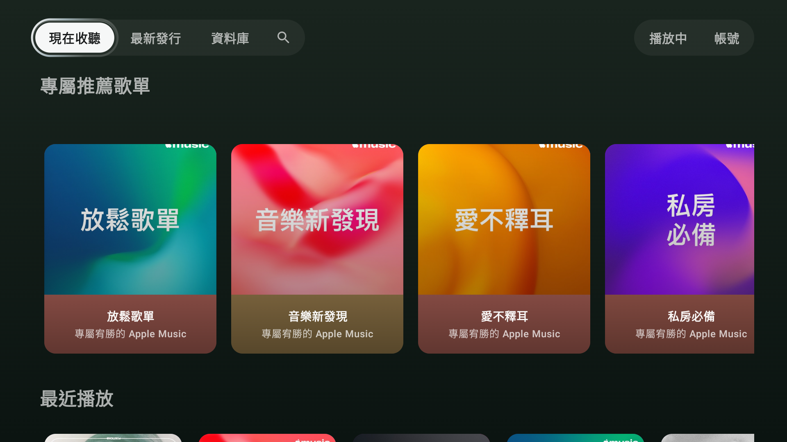
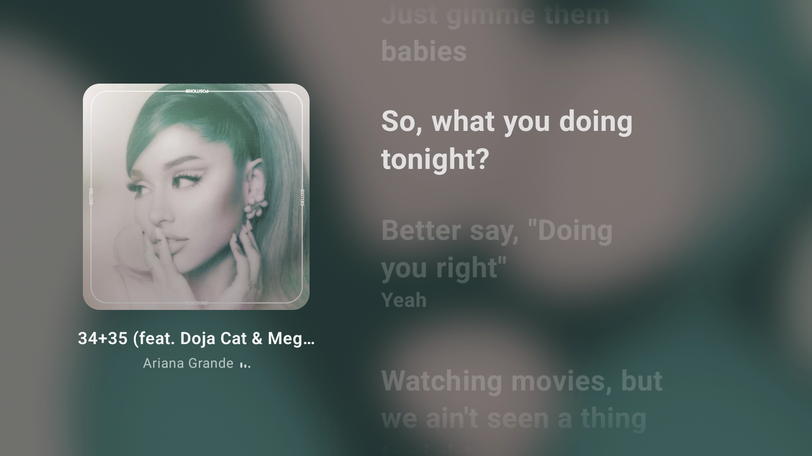
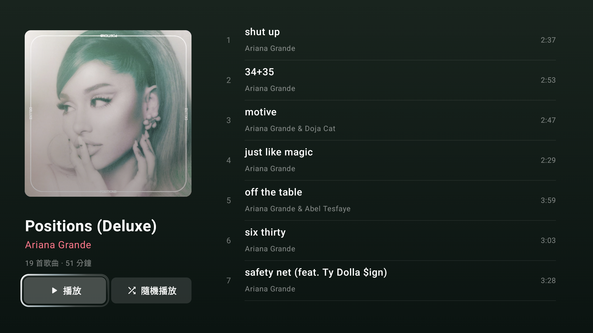
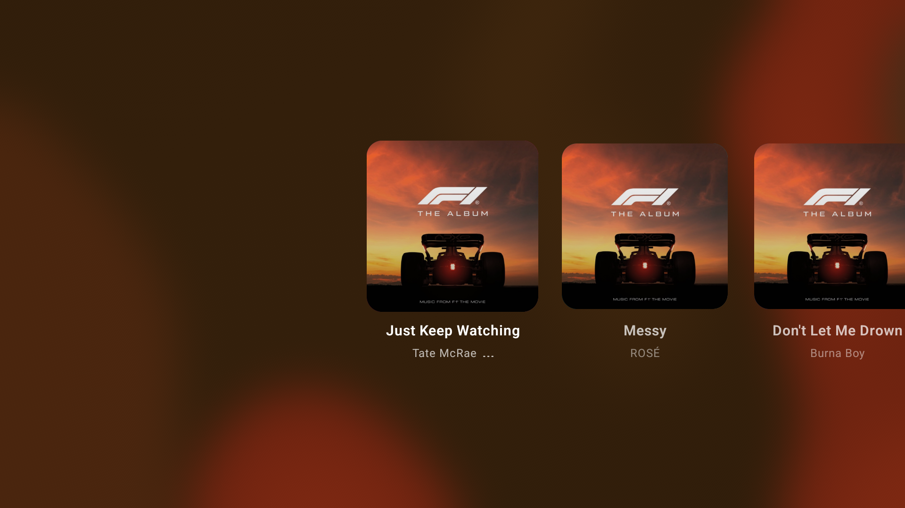

# AM for TV

**Android TV 上最流暢的 Apple Music 客戶端**

提供接近 Apple TV 原生 Apple Music 的使用體驗。

[English](README.md) · 繁體中文 · [简体中文](README.zh-CN.md)

## 功能

- 曲庫、搜尋、歌單、播放佇列與播放紀錄
- 逐字歌詞（和聲、長音、間奏、時間偏移）
- 封面取色背景與音樂頻譜動畫
- 自動接播推薦（Apple Music／YouTube Music）
- 封面／歌詞快取，英文／繁中／簡中介面

## 安裝

Android TV 9+，需 Apple Music 訂閱。安裝 APK 後登入 Apple Music。

## 截圖

| 主畫面 | 播放頁面 |
| --- | --- |
|  |  |

| 歌單 | 播放佇列 |
| --- | --- |
|  |  |


## 麥克風權限

`RECORD_AUDIO` 用於播放音訊的頻譜分析，不使用實體麥克風。

## 建置

需要 JDK 17、Android SDK 36 及官方 [MusicKit Android SDK](https://developer.apple.com/musickit/android/)。憑證設定見 [MusicKit 設定](docs/musickit-setup.md)。

```sh
./gradlew :app:assembleDebug
tools/build-standalone.sh
```

獨立版 APK 輸出至 `dist/`。簽章與打包方式見 [APK 與原始碼發佈](docs/standalone-distribution.md)。

## 授權

[MIT](LICENSE) · [第三方授權](app/src/main/assets/licenses/NOTICE.txt)
