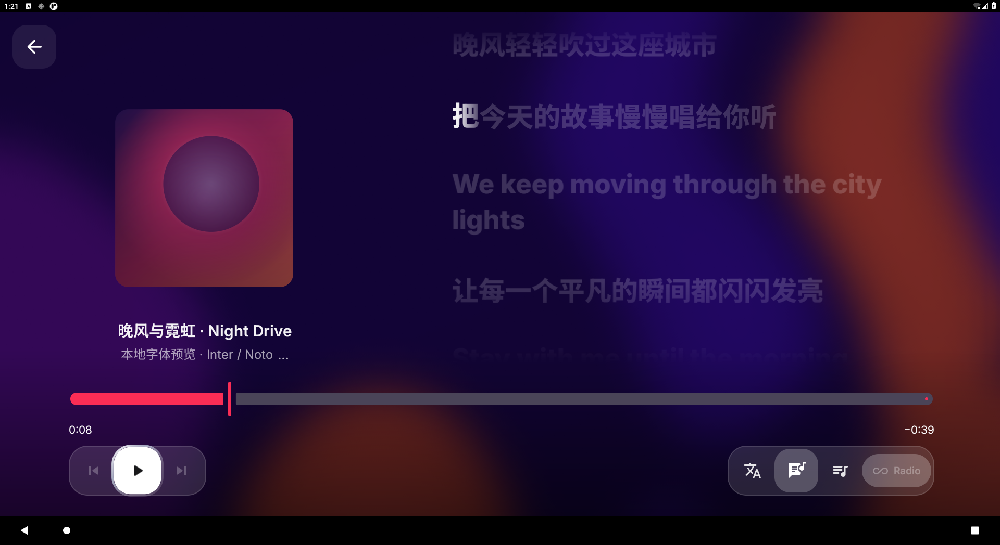
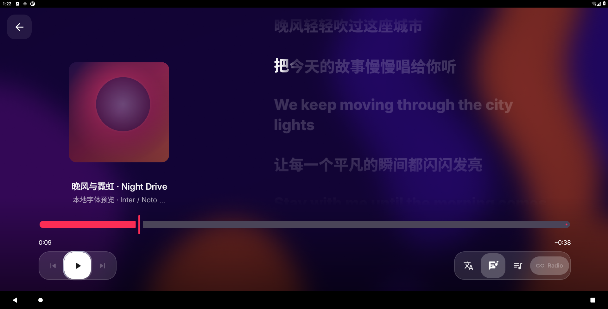
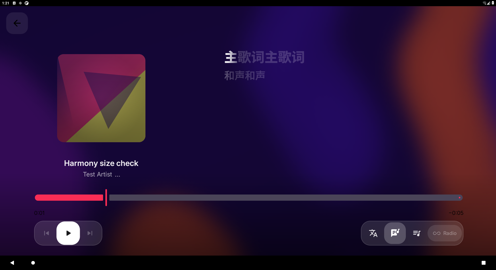

# Flyme Auto / 领克 06 适配

这是基于上游 `6754603` 的车机适配候选，分支 `flyme-auto`。实车登录采用用户已验证可用的 Gecko 方案；本次没有重新进行 Apple ID 登录、订阅播放或实车媒体源验证。

## 屏幕与交互

以 [autoenergy-fuel-mod 1.0.2](https://github.com/SakiTomato822/autoenergy-fuel-mod/tree/4a2398c191c987b4c5470bb5aaa98719c91a3335) 为参照：

- `OriginalEnergyView.kt` 的设计尺寸是 **1920×968**，通过宽高两个方向的较小比例适配实际窗口。
- `MainActivity.kt` 使用 `WindowCompat.setDecorFitsSystemWindows(window, true)`，记录实际内容尺寸和 system bar insets。
- 历史实车为物理 **1920×1080 / 160 dpi**；896 是历史应用配置高度，不作为固定设计尺寸。

本项目的 Compose 界面同样保留、显示状态栏和底栏，内容按真实窗口布局。`CarLayout` 以 1920×968 为缩放参照，将原 TV 控件放大到适合近距离触摸的大小，保留系统字体缩放；不会执行 `wm size` 或 `wm density`。窗口减少高度时，两轴取小值，避免按物理屏幕尺寸挤出底部控件。背景随整个内容窗口铺开。

车机变体：

- 不要求 Leanback；独立包名 `dev.amatv.flyme`，显示名 `AM for Flyme Auto`。
- 默认使用 Gecko 登录，独立 `:gecko_auth` 进程；ARM64 包。
- 横屏、可调整窗口大小；键盘使用 `adjustResize`。
- 播放控制常显；主按钮至少 56 dp；播放/暂停、上下曲、歌词、歌词设置、队列、队列模式及队列卡片有点击事件。
- 可触摸拖动进度条；播放页和歌单详情有返回入口。
- 低性能模式仅在没有已保存偏好时默认关闭；已保存的用户选择继续生效，可在设置中更改。
- 不因播放持续强制亮屏；不自动弹出频谱麦克风权限请求。

## 两层媒体接入

### Android MediaSession

复用上游 `PlaybackMediaSession`，继续发布标题、歌手、专辑、封面 URI、进度及播放状态，处理标准播放/暂停/上下曲/seek 命令。MusicKit 仍是 Android 音频焦点的所有者。

### Flyme 原生媒体源

本地参考材料：车机 `GeelyAutoMusic.apk`、`GeelyAutoMediaControl.apk`、Flyme Auto 2.5.0 包中的 `GeelyXSFMediaCenter.apk`。未把厂商 APK、反编译实现或厂商 AppId/AppKey 放进仓库。

确认的调用链：

1. 原厂音乐初始化 `MediaCenterAPI`，在 API ready 后调用 `registerMusic(自己的包名, MusicClient)`。
2. 注册返回 client token；随后 `updateMediaSourceTypeList(token, intArrayOf(6))`。
3. `6` 是在线音乐类型 `SOURCE_TYPE_ONLINE`，不是 Apple Music 专属编号。
4. 播放时申请媒体中心焦点，持续更新播放信息和进度；客户端回调接收播放/暂停/上下曲。
5. 媒体控制 UI 接收注册源列表和自定义源列表的变化。源注册成功与自定义源列表可见性要分别检查。

`FlymeMediaSource.kt` 是针对已观察协议编写的小型 Binder 互操作客户端。它通过正常导出的 OpenAPI 服务，以应用自己的 PID、UID、包名申请 `mediacenter`，核对 interface descriptor 后调用对应事务。系统拒绝访问时记录错误并保留标准 Android 媒体会话；没有绕过系统权限、冒用原厂包名或修改系统配置。

原生桥接仅对已检查的 MediaCenter `versionCode=26052922` 启用。相同 interface descriptor 不保证不同版本的事务编号一致，因此其他版本会拒绝原生连接，需要重新核对协议后再扩展。

已观察的线协议：

|接口|事务|用途|
|---|---:|---|
|`com.ecarx.sdk.openapi.IServicePool`|2|按 PID、UID、包名取得 `mediacenter` Binder|
|`ecarx.xsf.mediacenter.IMediaCenterSvc`|19|以本应用包名和客户端 Binder 注册|
|同上|7 / 8|声明源类型列表 / 当前源类型|
|同上|5|申请播放焦点|
|同上|6 / 10|更新播放元数据 / 进度|
|同上|4|注销客户端 token|
|`ecarx.xsf.mediacenter.IMusicClient`|1 / 2 / 3 / 4|播放 / 暂停 / 下一曲 / 上一曲|
|同上|10 / 11 / 12 / 13|读取播放信息 / 源列表 / 当前源 / 进度|

厂商播放状态 **0=暂停、1=播放、3=准备中**，与 Android PlaybackState 数值不同，已分别映射。客户端只声明已有的能力，不伪造收藏、下载、完整语音搜索或列表控制。下一曲/上一曲依据应用逻辑队列的可用性判断，不能用 MusicKit 单曲原生队列的边界替代。

媒体源选择仅打开本应用，不会自动播放。启动和恢复暂停队列也不会主动抢占焦点。用户请求播放时才调用媒体中心的 requestPlay；明确拒绝焦点时将暂停播放。底层 Binder 调用在工作线程，控制回调回到主线程；进度发布限为每秒一次。

### 列表显示条件

媒体中心同时读取 `/system/etc/appsource.property` 与自己的 `appSource/sourceConfig` 偏好配置，合并已安装应用、注册状态及源类型。某些列表读取自定义源配置，因此注册 token 成功不代表所有入口都显示新源。

必须先在当前车上读取这两份配置及 `AM-FlymeMedia` 日志，确认应用是否已被列出、是否启用、源类型是否包含 6，再判断是否需要单独的配置适配。当前实现不写这两份系统配置。协议目前依据 06 的样本，其他版本必须重新核对。

## 构建

按 [MusicKit 设置](musickit-setup.md) 放入官方播放与认证 AAR、配置开发者 token 或自己的 token endpoint。仓库不包含这些凭证或 SDK。

```sh
./gradlew :app:assembleFlymeGecko -PFLYME_SIGNING_KEYSTORE_FILE=/private/path/flyme.keystore
```

Windows 可以使用 `tools/build-flyme.ps1 -SigningKeystore C:\private\flyme.keystore`，也可以在本地配置 `FLYME_SIGNING_KEYSTORE_FILE`。输出文件为 `app/build/outputs/apk/flymeGecko/app-flymeGecko.apk`。Flyme.3 起正式包必须明确指定固定签名文件，使用现有 keystore 的 `androiddebugkey` 别名与 `android` 密码；同一路径内容、别名和证书应与 Actions 使用的 keystore 保持一致。预览包不受此要求影响。该变体使用独立包名，不继承上游包的数据。

### GitHub Actions 测试版

`.github/workflows/flyme-auto.yml` 仅手动触发，检出 `flyme-auto` 分支，运行 JVM 测试并在成功后发布 ARM64 预发布 APK。工作流需同时存在于默认分支，才能在 Actions 页面手动运行。不要在公开源码中填写凭证或 SDK 下载地址。

仓库 Actions Secrets：

- `MUSICKIT_SDK_DOWNLOAD_URL`：维护者已下载的官方 SDK ZIP 的临时受控下载地址。地址过期后需刷新，工作流不会将 SDK AAR 作为发布附件。
- `AM_DEVELOPER_TOKEN`：经许可使用的开发者 Token。编译后会内置进 APK，因此 APK 接收者能够提取它；Secrets 只保护源配置和日志，不能使 APK 内的 Token 保密。公开发布前需明确授权相应使用范围。
- `FLYME_SIGNING_KEYSTORE_BASE64`：固定 keystore 的 Base64。CI 还原到 `work/ci/flyme-signing.keystore`，再通过 `FLYME_SIGNING_KEYSTORE_FILE` 明确传给 Gradle。使用 `androiddebugkey` 别名与 `android` 密码，发布前校验证书指纹；不要上传私钥到 Releases。

工作流对 ZIP 和两份 AAR 校验 SHA-256，检查 Token 格式和有效期，并核对最终 APK 签名、包名、ARM64 MusicKit/Gecko 库及关闭演示模式。Actions 无法代替实车登录和播放测试。

普通构建会检查官方播放/认证 AAR 和 token/endpoint 配置，缺失时明确失败，避免把缺少真实播放引擎的演示包当成车机交付包。

Windows 的 `tools/build-flyme-preview.ps1` 可生成独立包名 `dev.amatv.flyme.preview` 的 ARM64 界面预览包，用于手机横屏检查字体、歌词和触摸控件。该包显示本地演示歌曲，不代表 Apple Music 登录或播放可用；窗口缩放允许适配手机较高密度。正式车机包仍使用车机缩放范围。

如需只使用标准 Android MediaSession 排查原生接入问题：

```sh
./gradlew :app:assembleFlymeGecko -Pflyme.nativeMedia=false -PFLYME_SIGNING_KEYSTORE_FILE=/private/path/flyme.keystore
```

检查原生媒体源：

```sh
adb logcat -s AM-FlymeMedia
adb shell dumpsys media_session
```

`Registered online source (6)` 只代表服务返回 token 并接受源类型，不代表已经通过实车列表、方向盘或仪表验证。`SecurityException`、null Binder、descriptor 不匹配都必须保留原始错误，不能当作成功。

## 验证范围

- 尺寸单元测试覆盖 1920×968、1920×896、分屏及较大窗口。
- Android instrumentation 使用真实 Parcel 和模拟系统 Binder，验证注册身份、类型 6、无启动抢播、未知协议拒绝、控制回调及厂商状态编码。
- 触屏 smoke test 使用未配置账号的演示界面，检查播放控件常显、队列和返回。
- 模拟器的 `-Pflyme.uiVerification=true -Pamatv.testBuildType=flymeGecko` 使用 x86_64、关闭缩减并启用调试，只用于测试；正式车机包仍为 ARM64。
- 本地已接入用户提供的官方 `mediaplayback-release-1.1.1.aar` 和 `musickitauth-release-1.1.2.aar`，播放库通过上游 SHA-256 校验。SDK 文件仅保存在被 Git 忽略的 `app/libs`，不随仓库分发。真实登录、DRM 和播放仍需开发者 token 配置及 ARM64 实机验证。

实车仍需核对：1920×968 与实际系统栏安全区、Gecko 登录、长时间后台播放、导航/电话打断与恢复、媒体源列表、方向盘控制、封面和仪表显示、重启后的源恢复。此清单是交付验收范围，不是本次已完成的实车测试结果。

### 本次验证记录（2026-10-28）

- 376 项 JVM 单元测试通过，0 failures / 0 errors。
- Android 11 / API 30 模拟器：6 项测试通过（4 项 Binder、1 项中英混排字体、1 项触屏 smoke test）。触屏测试覆盖歌词字号循环与持久化、播放/暂停、队列、返回、5 秒后控制仍可见。
- 单独断言状态栏和导航栏均可见，测量到 **1920×968** 与 **1920×896** 两种真实内容区；两者 UI smoke test 均通过。模拟器系统栏为 top=24 / bottom=56；这不是 Flyme 实车系统栏尺寸。
- 接入真实 SDK 后，x86_64 预览构建、instrumentation 测试 APK 和 JVM 测试构建通过；当前正式构建停在开发者 token/endpoint 缺失检查，尚未交付可播放版。早期缺少 SDK 时使用过仅编译接口，当前验证已移除该临时依赖。

字体使用 Inter 和 Noto Sans SC，许可证及文件校验见 [字体记录](flyme-fonts.md)。歌词提供标准、大、特大三档；当前目标布局为左侧专辑封面、右侧歌词和底部全宽播放控制。

### 首次实车反馈后的修正

- 修复原生 Typeface 包装忽略 Compose 请求字重的问题，主歌词使用实际 800 字重；歌词三档放大为 TV 基准的 125% / 155% / 185%。
- 账号页的设置区域增加“原厂媒体桥接状态”，保留具体失败原因，例如媒体中心版本不匹配、授权失败或注册 token 缺失。此页面用于实车定位，不把标准 MediaSession 或 EVCC 转发成功当作原厂注册成功。
- 用户实测：EVCC 控制正常，部分歌曲有歌词，但 AM 的原厂媒体源未出现。当前原厂 Binder 歌词字段仍为空，标准 MediaSession 也尚未附加歌词；EVCC 官方手册说明，无歌词广播时会联网搜索，所以 EVCC 显示的歌词不能作为本应用原厂歌词桥接成功的证据。
- 此前曾按 Cider 参考图改为通高封面和渐进模糊；该布局与模糊效果已撤回，不代表当前实现。当前恢复左侧专辑封面、右侧歌词、底部全宽播放控制，状态栏与底栏常显。
- 主歌词保留 800 字重；和声在逐字、逐行、静态三种模式中使用约六成字号与较轻的 600 字重，注音和译文进一步缩小。对唱另一位歌手的主歌词不缩小。渲染和行高估算共用同一套尺寸。
- 浏览导航和控件按压增加短促的 Material 3 风格过渡。低性能模式仅对没有既有偏好值的安装默认为关闭，不覆盖已保存选择。
- 资料库按播放列表、艺人、专辑、歌曲提供四个入口，保存资料库资源 ID 并支持分页；实机账号中的实际内容仍需用户验证。

### 历史验证记录（2026-10-29；针对后来撤回的 Cider 布局）

- 399 项 JVM 单元测试通过，0 failures / errors。
- API 30 模拟器 10 项 Android 测试通过：4 项原厂桥接 Binder、2 项真实字体、1 项触控流程、1 项和声三种模式、1 项四个资料库分类、1 项当时的模糊渲染测试。模糊测试和截图只记录已撤回的实现，不作为当前布局的验证。
- 当时检查了 1920×968、1920×896 和 1280×896 内容区播放控制及系统栏；这些结果来自旧布局，当前恢复布局和新增动画尚未据此验收。
- 以上历史模拟器结果不代表原厂媒体源注册、EVCC 歌词互通或真实账号资料库已经通过实车验收。

### Flyme.3：EVCC 主歌词输出

- 根据官方 EVCC 3.4.5 APK 的实际接收逻辑，通过现有 Android MediaSession 的 `lyrics` 字符串字段发送原文主歌词。已有时间轴发送完整 LRC，静态内容保留纯文本；和声、译文、注音不进入外部输出，应用内和声显示继续保留。
- 账号歌词异步加载完成后主动刷新系统播放元数据，并按歌曲身份及播放请求代次隔离旧结果。歌词版本与元数据更新关联，切歌/清会话清理应用自己的旧数据。
- 当时记录了 414 项 JVM 测试和 API 30 的 12 项 Android 测试通过，包含真实 MediaController 读回、迟到歌词、和声过滤及切歌清理。没有安装或运行 EVCC；实际车机联动仍需验收。该历史结果不验证本次布局及动画改动。
- 不依赖 EVCC 的独立原厂桥接改进按用户要求暂缓，不包含在本次发布中。接收规则、静态检查依据和 EVCC 自身缓存限制见 [EVCC 歌词输出](evcc-lyrics.md)。
- 实际证书比对发现前两版 CI 使用了不同的临时签名，旧私钥未保留。Flyme.3 起通过 `FLYME_SIGNING_KEYSTORE_FILE` 明确指定固定 keystore，并校验 `91f7b9…78bab8d` 证书；旧两版迁移需要卸载重装并重新登录一次，后续固定签名版本可覆盖更新。

### Flyme.4：实车反馈修正

- 恢复此前的播放页布局，移除 Cider 布局和新增的渐进模糊。保留主歌词实际 800 字重、和声约六成字号及 600 字重。
- 页面、资料库分类与内容状态使用短距离滑动和淡入淡出；卡片与播放按钮增加按压反馈，播放图标与歌曲标题增加切换动画。没有已保存偏好时，低性能模式默认关闭。
- EVCC 输出按原文 token 边界组合句子，修复中文逐字插空格、英文按音节拆词。新增真实 TTML 解析到 LRC 的回归测试。EVCC 可能仍保留同曲的旧缓存。
- 电台卡片现在启动播放；MusicKit 使用 Apple 文档的 `RADIO_STATION=3` 容器和原始 station ID，电台上下曲交给 SDK，应用自己的推荐队列与循环模式不接管电台。直播不恢复位置、不显示拖动进度、不发布 seek 能力，媒体时长为 0。
- 本地 playback AAR 1.1.1 缺少具名电台常量，因此使用官方文档的数值。真实 AAR 队列 provider 构建测试通过；这不能证明该版本的原生引擎、账号或地区一定能播放电台，仍需设备验证。
- 405 项 JVM 测试、API 30 的 19 项 Android 测试通过。包含真实 MediaController 元数据/控制回读、非零直播位置准备、禁用 seek、原生 AAR provider 构建和转场期间焦点隔离。恢复布局在 1920×968、1920×896、1280×896 内容区完成触控检查，保留系统栏。真实账号、电台出声及 EVCC 实车显示仍需验收。
- versionCode 18；沿用 Flyme.3 的固定签名，可覆盖更新并保留应用数据。Actions 会在发布前验证证书。

以下是本地演示歌曲的当前布局，不代表实车播放结果。

|1920×968 内容区|1920×896 内容区|
|---|---|
|||


